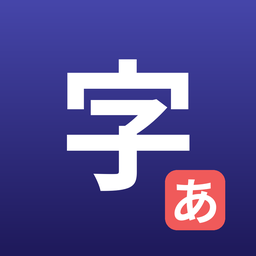

# KanjiKanaTrainer

An iPad and iPhone app for learning to **write** Chinese characters and Japanese kana by hand, one
stroke at a time. Watch a character draw itself in the correct order, hear it spoken, then write it
yourself with Apple Pencil or a finger and get a score that checks what a teacher checks: the right
strokes, in the right order and direction, in roughly the right place.

It was built for a young learner in a Mandarin immersion classroom, so it is forgiving about exact
shape, quick to start, and keeps everything on the device: no account, no server, no ads.

App Store Connect name: **KanjiKanaTrainer** · bundle `com.headydiscy.KanjiKanaTrainer` · iOS / iPadOS
(also runs on Apple silicon Macs). Personal project, not yet published on the App Store.

---

## What you can do

| Mode | What it is |
|------|------------|
| **Demo** | The character draws itself stroke by stroke in the correct order, then is read aloud. |
| **Practice** | Write the character on a PencilKit canvas and tap **Evaluate** for a score and a short hint. |
| **Sequential demo** | Play through a whole set (a kana row, the numbers 1–10, "family" words…) one character after another. |
| **Sequential practice** | Write your way through a set in order, with the score, your best score and how many tries you have made shown for each character. |
| **Pronunciation** | Every character can be read aloud on the device: Mandarin voice for Chinese, Japanese voice for kana. |
| **Progress** | Every scored attempt is saved on the device, so each character shows your best score and number of tries. |

## What's inside

**Chinese (simplified, with pinyin)**

| Set | Characters |
|-----|------------|
| Numbers | 0–10, 1–10, 11–19, 20–30, 1–30, and large numbers 十 百 千 万 億 — compound numbers such as 二十一 are built from their parts |
| Nature | 日 月 水 火 木 金 土 山 天 地 … |
| Body | 人 口 手 目 耳 心 |
| Size & direction | 大 小 中 上 下 左 右 |
| Objects & animals | 田 石 门 女 子 马 牛 羊 鸟 鱼 米 竹 … |
| Verbs | 来 去 出 入 吃 喝 看 听 说 读 写 走 飞 坐 站 |
| Pronouns & common words | 我 你 他 她 不 也 了 在 有 好 开 生 学 工 用 |
| First 100 themes | greetings, introductions, family, time, school, food |

**Japanese** — hiragana and katakana, row by row (vowels, K, S, T, N, H, M, Y, R, W + ん) or all 46 at once.

## How scoring works

`StrokeEvaluator.swift` (`DefaultAttemptEvaluator`) compares your strokes with the reference strokes:

1. **Same scale.** Your strokes (canvas points) and the reference (0–1 for kana and numbers, the
   0–1024 grid for the other Chinese characters) are each fitted into the same unit square, so the
   score does not depend on canvas size or on which data file a character came from.
2. **Stroke count.** Too many or too few strokes scales the whole score down.
3. **Order and direction.** For each stroke, the reference stroke it looks most like must be the one
   that belongs at that position; a stroke written the wrong way round gets half credit. Dots can go
   any way.
4. **Shape.** Each stroke is resampled to 16 points and compared point by point with its reference,
   with a generous tolerance.

The score shown is the average of order and shape. Above 80% is green ("Great job! 🎉"); below it,
the hint says whether to watch the stroke order again or match the shape more closely.

Checked on the bundled data: every one of the 287 reference characters, redrawn with a 2% wobble at
canvas size, scores at least 92%; a different character with the same number of strokes scores a
median of 25%.

## Progress

`ProgressRepository.swift` saves each scored attempt (character, order, shape, total, date) with
SwiftData in the app's own store on the device. Nothing leaves the device.

## Project layout

| Path | Contents |
|------|----------|
| `KanjiKanaTrainerApp.swift`, `RootView.swift` | App entry, license gate, home screen |
| `Domain/` | Models, view models, pronunciation |
| `Environment/` | Dependency wiring (`AppEnvironment`: glyphs, progress, evaluator) |
| `GlyphRepository.swift` | Character list: literal, pinyin / romaji, Cantonese jyutping, meaning |
| `StrokeDataLoader.swift`, `ChineseStrokeDataLoader.swift` | Load and orient the stroke JSON |
| `StrokeEvaluator.swift` | Scoring |
| `ProgressRepository.swift` | Saved progress (SwiftData) |
| `*SetSelector.swift`, `Sequential*.swift`, `LessonView.swift`, `PracticeView.swift` | Screens |
| `strokedata/` | Stroke data: `kanastrokes.json`, `chinesenumbers.json`, `chinese_stroke_data.json` |
| `KanjiKanaTrainerTests/` | Swift Testing tests (`@testable import KanjiKanaTrainer`), including `StrokeEvaluatorTests` |
| `Docs/` | Implementation notes and the data-preparation scripts |
| `download_kana_strokes_json_fixed.py` | Rebuilds the kana stroke file from KanjiVG |

## Build and test

Open `KanjiKanaTrainer.xcodeproj` in Xcode, choose an iPad simulator or device, and run. Run the
tests with **Product → Test** (⌘U). Requires iOS / iPadOS 27.0.

## Third-party data

Stroke data comes from two open datasets, and those files stay under their original licenses:

- **[KanjiVG](https://kanjivg.tagaini.net)** by Ulrich Apel, licensed under
  [CC BY-SA 3.0](https://creativecommons.org/licenses/by-sa/3.0/). Used for kana and Chinese numbers.
- **[hanzi-writer-data](https://github.com/chanind/hanzi-writer-data)**, derived from Make Me a Hanzi
  and the Arphic PL fonts. Used for Chinese characters. See that repository for its license terms.

## License

Copyright © 2025–2026 Zahirudeen Premji. All rights reserved. See [LICENSE](LICENSE). The third-party
stroke data listed above is excluded.
